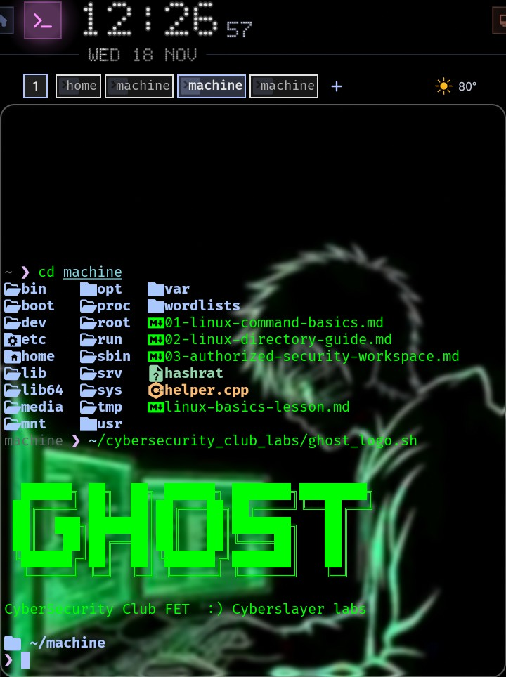

# Linux Command-Line Basics

## Class notes and commands

This lesson introduces the shell as a way to navigate files, run programs, connect commands, and manage users and access permissions. Type the commands in a terminal and read the explanation beside each section. Examples that use `sudo` require an account with administrative privileges.

> **Termux note:** Termux is an Android app environment, not a standard Linux distribution with its own system users and groups. Commands such as `useradd`, `groupadd`, `usermod`, and `chown` are intended for a regular Linux system or Linux virtual machine. Some command options may also differ between Linux distributions.

---

## 1. How a shell command is written

A command usually has this form:

```text
command [options] [arguments]
```

- **Command** is the program to run, such as `ls`.
- **Option** changes how it runs, often written with `-` or `--`, such as `-l` or `--all`.
- **Argument** is the item the command acts on, such as a directory or filename.

For example:

```sh
ls -l /etc
```

Here, `ls` is the command, `-l` is an option asking for a detailed listing, and `/etc` is the argument telling it which directory to list.

Commands are case-sensitive. `File.txt` and `file.txt` are different names. Spaces separate arguments, so quote a path that contains spaces:

```sh
ls -l "class notes"
```

### Getting help quickly

Many programs provide a short usage summary:

```sh
ls --help
cp --help
```

Some commands, especially shell built-ins, may use:

```sh
help cd
```

For a fuller reference, use the manual pages described in section 10.

---

## 2. Where you are and what is around you

### Print the current directory

```sh
pwd
```

`pwd` means “print working directory.” The working directory is where relative paths are interpreted and where commands such as `touch file.txt` create files.

### List files

```sh
ls
ls -l
ls -a
ls -la
```

- `ls` lists visible names.
- `-l` shows details such as permissions, owner, size, and modification time.
- `-a` includes hidden names beginning with a dot, such as `.profile`.
- Options can often be combined, as in `-la`.

### Change directories

```sh
cd /etc
pwd
cd ..
pwd
cd ~
pwd
cd -
```

- `cd /etc` changes to an absolute path, which starts from `/`.
- `cd ..` moves to the parent directory.
- `cd ~` moves to your home directory. `~` is shorthand for the home path.
- `cd -` returns to the previous directory.

A relative path is interpreted from the current directory. If you are in `/home/lee`, then `cd documents` means `/home/lee/documents`.

Useful path symbols:

| Symbol | Meaning |
|---|---|
| `/` | The root of the filesystem, or a separator between directories. |
| `.` | The current directory. |
| `..` | The parent directory. |
| `~` | The current user's home directory. |

---

## 3. Creating and managing files and directories

### Make directories

```sh
mkdir classwork
mkdir -p classwork/week1/notes
```

`mkdir` creates directories. `-p` creates any missing parent directories and does not complain if the directory already exists.

### Create empty files

```sh
touch notes.txt summary.txt questions.txt
```

`touch` creates empty files if they do not exist. If a file exists, it updates its modification time.

### Copy, move, and rename

```sh
cp notes.txt notes-copy.txt
cp -r week1 week1-backup
mv notes-copy.txt old-notes.txt
mv old-notes.txt classwork/
```

- `cp SOURCE DESTINATION` copies a file.
- `cp -r` copies directories and their contents recursively.
- `mv` moves a file or directory. It also renames when the destination is another name in the same directory.

### Remove files and directories

```sh
rm old-notes.txt
rmdir empty-directory
```

`rm` removes files. `rmdir` removes an empty directory. Recursive removal with `rm -r` can delete many files; inspect the path carefully before using it. Avoid copying commands with `rm -rf` into a terminal unless you understand exactly what path they target.

### Read text files

```sh
cat notes.txt
less /etc/hosts
head -n 5 notes.txt
tail -n 5 notes.txt
tail -f application.log
```

- `cat` prints a file, and is convenient for short files.
- `less` lets you move through a longer file. Press `q` to quit, `/word` to search, and `n` for the next match.
- `head` prints the first lines; `tail` prints the last lines.
- `tail -f` waits and displays new lines as another program adds them to the file. Press `Ctrl-C` to stop following.

---

## 4. Variables, `$`, and command substitution

A variable stores a value for later use in the current shell. In Bash, assign it with no spaces around `=`:

```sh
course="Linux basics"
echo "$course"
```

`$course` expands to the value stored in `course`. Double quotes keep the value together if it contains spaces. Prefer `"$variable"` when passing a variable as a filename or argument.

Some variables are supplied by the environment:

```sh
echo "$HOME"
echo "$PATH"
echo "$PWD"
```

- `HOME` is the user's home directory.
- `PATH` lists directories where the shell looks for executable commands.
- `PWD` is the current working directory.

Export a variable to make it available to programs started by the shell:

```sh
export COURSE="Linux basics"
```

Command substitution runs a command and places its output inside another command:

```sh
today=$(date +%F)
echo "Today's date is $today"
```

The older form using backticks also exists, but `$(...)` is easier to read and can be nested more safely.

---

## 5. Standard input, output, and errors

A running command normally has three standard streams:

| Stream | Number | Purpose |
|---|---:|---|
| Standard input | 0 | Data read by the command, commonly from the keyboard or a pipe. |
| Standard output | 1 | Normal results. |
| Standard error | 2 | Warnings and error messages. |

### Redirect output to files

```sh
ls -l > listing.txt
```

`>` sends standard output to a file and replaces the file's previous contents. Use `>>` to append instead:

```sh
echo "Another note" >> notes.txt
```

Redirect errors separately with `2>`:

```sh
find /etc -name '*.conf' > found-files.txt 2> find-errors.txt
```

This saves normal results to `found-files.txt` and errors to `find-errors.txt`.

Send both normal output and errors to one file in a portable shell form:

```sh
command > all-output.txt 2>&1
```

The order matters: first standard output is sent to the file, then standard error is sent to the same place as standard output. In Bash, `&> all-output.txt` is a shorter equivalent, but `> file 2>&1` works in more shells.

Discard output you do not need by redirecting it to `/dev/null`:

```sh
command 2> /dev/null
```

Use this sparingly: discarding errors can hide useful information when diagnosing a problem.

### Read input from a file

```sh
sort < names.txt
```

`<` connects a file to the command's standard input.

---

## 6. Pipes: connecting command output

A pipe, written `|`, connects the standard output of one command to the standard input of another. It lets you process information in steps without creating an intermediate file.

```sh
ls -la | less
```

`ls` produces a listing; `less` displays it page by page.

More examples:

```sh
cat names.txt | sort
```

Sorts the lines from `names.txt`. For this simple case, `sort names.txt` is shorter, but the pipe demonstrates how streams connect.

```sh
grep -i 'error' application.log | sort -u
```

- `grep` selects lines containing `error`.
- `-i` ignores letter case.
- `sort` orders the selected lines.
- `-u` keeps only one copy of duplicate lines.

```sh
ps -ef | less
```

Displays the process listing page by page on systems where `ps -ef` is supported.

### A pipe sends standard output by default

Errors normally remain attached to the terminal instead of going through a pipe. To send both output and errors through a pipe, use:

```sh
find /etc -name '*.conf' 2>&1 | less
```

In Bash, `|&` is shorthand for piping both standard output and standard error:

```sh
find /etc -name '*.conf' |& less
```

`|&` is supported by Bash and some other shells, but `2>&1 |` is more portable.

### Keep errors on screen while saving normal output

In Bash, `tee` can copy standard output to a file while still showing it:

```sh
find /etc -name '*.conf' 2> find-errors.txt | tee found-files.txt
```

Here the normal results appear on screen and are saved in `found-files.txt`; errors go to `find-errors.txt`.

### Pipeline exit status

By default, a pipeline's status is usually the status of its last command. For example, a successful `less` may make the whole pipeline appear successful even if an earlier command failed. Bash can report a failure from any pipeline stage with:

```sh
set -o pipefail
```

This affects the current shell, so in a script it is often used near the top alongside `set -e` when appropriate.

---

## 7. Searching for files and text

### Find files by name

```sh
find . -name '*.txt'
find "$HOME" -type f -name 'notes*'
```

- The first example searches under the current directory (`.`).
- `-type f` limits results to regular files.
- Quotes keep the `*` wildcard for `find` to interpret rather than letting the shell expand it first.

Search hidden directories too: `find` includes them unless told otherwise.

### Search inside files

```sh
grep 'warning' application.log
grep -in 'warning' application.log
grep -RIn 'TODO' classwork
```

- `grep` prints lines matching a pattern.
- `-i` ignores case; `-n` prints line numbers.
- `-R` searches directories recursively.
- `-I` skips binary files in many grep implementations.

### Count lines, words, and bytes

```sh
wc notes.txt
wc -l notes.txt
```

`wc` counts lines, words, and bytes. `wc -l` prints only the line count.

---

## 8. Users and groups

Users and groups determine ownership and access on a multi-user Linux system. Administrative commands in this section change system accounts, so use a test VM or a Linux machine where you are authorized to administer accounts.

### Inspect the current account

```sh
whoami
id
id username
```

`whoami` prints the current username. `id` displays the current user's numeric ID and group memberships. `id username` inspects another account.

### Create a group and user

On many Debian/Ubuntu-based systems:

```sh
sudo groupadd course-team
sudo useradd -m -s /bin/bash -g course-team learner1
sudo passwd learner1
```

- `sudo` runs a command with administrative privileges after confirming authorization.
- `groupadd` creates a group.
- `useradd -m` creates a home directory.
- `-s /bin/bash` selects Bash as the login shell, if Bash is installed at that path.
- `-g course-team` sets the user's primary group.
- `passwd` sets or changes the account password interactively.

Some distributions provide an interactive `adduser` command instead:

```sh
sudo adduser learner2
```

Options and default behavior vary by distribution. Check `man useradd`, `man adduser`, and `man groupadd` on the system you are teaching.

### Add an existing user to another group

```sh
sudo usermod -aG course-team learner2
```

`-a` means append, and `-G` lists supplementary groups. Keep `-a` when adding supplementary groups; omitting it can replace the user's existing supplementary group list. The user may need to start a new login session for the new membership to appear.

Check membership:

```sh
id learner2
getent group course-team
```

### Ownership

A file has an owner and a group. Change them with `chown` as an administrator:

```sh
sudo chown learner1:course-team notes.txt
sudo chown -R learner1:course-team shared-folder
```

`-R` applies the change recursively to a directory and its contents. Use it only when the full tree should have the new ownership.

---

## 9. File permissions

Run `ls -l` to view permissions:

```sh
ls -l notes.txt
```

Example output begins with:

```text
-rw-r----- 1 learner1 course-team 120 May 20 10:30 notes.txt
```

The first character indicates the file type (`-` regular file, `d` directory, `l` symbolic link). The next nine characters are permissions in three groups:

```text
owner permissions | group permissions | other users' permissions
```

Each group can have:

- `r` — read. For a file, view its contents. For a directory, list names in it.
- `w` — write. For a file, change its contents. For a directory, create, rename, or remove entries, subject to other permissions.
- `x` — execute. For a file, run it as a program if it is executable. For a directory, enter or traverse it.

### Numeric permissions

The numeric values are `r = 4`, `w = 2`, and `x = 1`. Add the values for each class:

| Number | Permission for that class |
|---:|---|
| `0` | no permissions |
| `1` | execute only |
| `2` | write only |
| `3` | write and execute |
| `4` | read only |
| `5` | read and execute |
| `6` | read and write |
| `7` | read, write, and execute |

A three-digit mode is owner, group, then others:

```sh
chmod 640 notes.txt
chmod 750 shared-folder
chmod 700 private-directory
```

- `640`: owner can read/write; group can read; others have no access.
- `750`: owner has full access; group can read and traverse/execute; others have no access.
- `700`: only the owner has access.

Directory execute permission is necessary to access items within it by name. A user who can read a directory but cannot execute it may see names but cannot traverse into the directory.

### Symbolic permissions

Symbolic notation can be easier when changing only one permission:

```sh
chmod u+x script.sh
chmod g-w shared-file.txt
chmod o-r private.txt
chmod u=rw,g=r,o= notes.txt
```

- `u` is owner/user, `g` is group, `o` is others, and `a` is all classes.
- `+` adds a permission, `-` removes it, and `=` sets that class to exactly the listed permissions.

### Group collaboration on a directory

A common pattern is to set a directory's group and allow group members to work in it:

```sh
sudo chown -R learner1:course-team shared-folder
chmod 2770 shared-folder
```

The leading `2` sets the set-group-ID bit on the directory. New files and directories created inside commonly inherit the directory's group. This is useful for team workspaces; exact behavior can depend on filesystem and system settings.

### Default permissions and `umask`

New files and directories start with default permissions modified by the shell's `umask`:

```sh
umask
umask -S
```

A common `umask` is `022`, which generally results in directories with `755` and files with `644` (programs may use different requested base permissions). A more restrictive `077` generally gives private files and directories to the owner. `umask` removes permissions; it does not add them.

---

## 10. Learning from manual pages (`man`)

Manual pages are the system's detailed command reference. They explain what a command does, its options, accepted arguments, examples, related commands, and sometimes caveats.

```sh
man ls
man grep
man chmod
```

Inside a manual page:

- Press `Space` to move forward one page.
- Press `b` to move back one page.
- Type `/pattern` and press Enter to search for a word.
- Press `n` to go to the next search result.
- Press `q` to quit.

Useful manual sections include:

```sh
man 1 ls
man 1 printf
man 5 passwd
man 5 group
man 8 useradd
```

The section number can distinguish a command from a configuration-file format with the same name. Common sections include 1 for user commands, 5 for file formats, and 8 for system administration commands.

If you do not know the command name, search manual page descriptions:

```sh
man -k permissions
apropos permissions
```

`man -k` and `apropos` search short manual descriptions. On some systems, the manual-page index may need to be installed or updated. For a short command summary, try:

```sh
command --help
```

Not every program has a manual page, and options can differ between Linux distributions. Read the manual on the machine where the command will run. When unsure, check the synopsis and examples before running a command that changes or deletes data.

---

## 11. Class reference: useful commands at a glance

| Command | Main use |
|---|---|
| `pwd` | Show current directory. |
| `ls -la` | List files, including hidden entries, with details. |
| `cd DIR` | Change working directory. |
| `mkdir -p DIR` | Create directories and missing parents. |
| `touch FILE` | Create an empty file. |
| `cp SRC DEST` | Copy files. |
| `mv SRC DEST` | Move or rename files. |
| `cat FILE` / `less FILE` | Print a short file / read a longer file interactively. |
| `find PATH ...` | Search for files and directories. |
| `grep PATTERN FILE` | Select lines matching text. |
| `sort FILE` / `uniq` | Sort lines / remove adjacent duplicate lines. |
| `wc -l FILE` | Count lines. |
| `whoami` / `id` | Inspect user and group identity. |
| `chmod MODE FILE` | Change permissions. |
| `chown USER:GROUP FILE` | Change ownership. |
| `groupadd`, `useradd`, `usermod` | Manage groups and accounts; administrator access required. |
| `man COMMAND` | Read the command's manual. |
| `>` / `>>` / `2>` | Redirect output, append output, or redirect errors. |
| `\|` | Pipe one command's standard output into another command. |

## 12. Habits that prevent common mistakes

1. Use `pwd` to confirm your location before changing or removing files.
2. Quote variables and paths: `"$HOME/some directory/file.txt"`.
3. Read command help or its manual before using unfamiliar options.
4. Remember that `>` replaces a file; use `>>` when you mean to append.
5. Remember that a pipe carries standard output by default; redirect standard error explicitly if you need it.
6. Use `sudo` only for commands that need administrative privileges and only on systems you administer.
7. Inspect permissions with `ls -l` before changing them. Avoid `chmod 777` as a general fix; it gives every local user write access.
